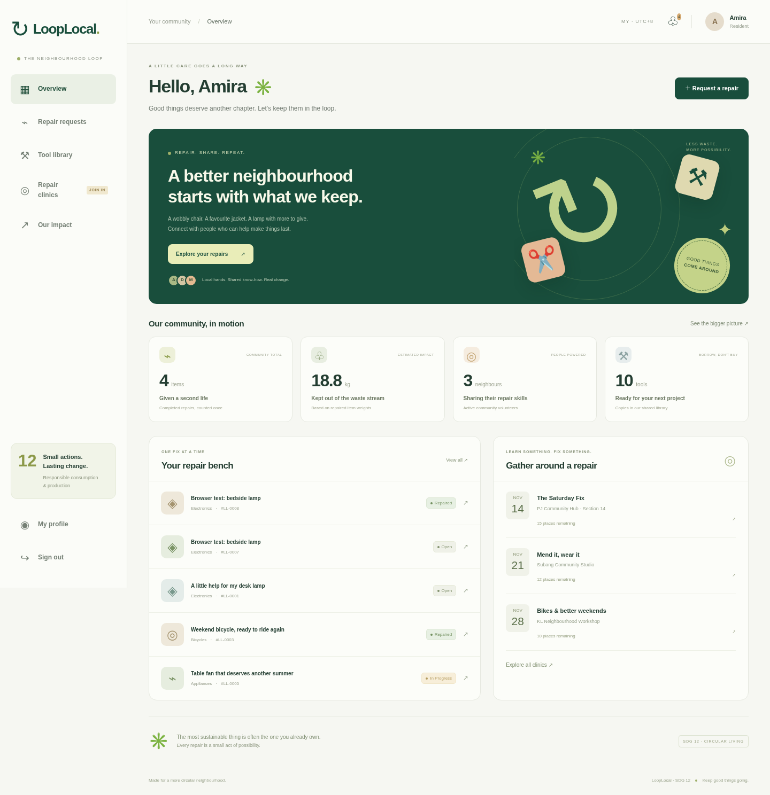

# ↻ LoopLocal
### Repair what you love. Share what you have. Keep good things going.

A complete, runnable Software Engineering FYP web application connecting Malaysian neighbourhoods with repair volunteers, shared tools and practical repair clinics. Supports **UN SDG 12**, particularly **Target 12.5: waste prevention, reduction and reuse**.

> 中文项目介绍与答辩流程：[docs/PROJECT_ZH.md](docs/PROJECT_ZH.md)。UI is in English. This repository contains the application, persistent database schema, demo seed command, tests, screenshots, deployment scripts and software engineering documentation.



## Why this project?

Repair information, volunteer availability, tools and event registration are often separated. LoopLocal connects the entire journey: request a repair → explainable volunteer suggestions → claim and discuss → record the repair → share a privacy-conscious **item repair passport**. The same community can reserve tools and attend repair clinics. See [research and references](docs/RESEARCH.md) for the public projects consulted and the limits of this comparison.

## Working features

| Module | Implemented behaviour |
|---|---|
| Accounts | Resident / repair volunteer registration, hashed passwords, login/logout, password changes, profile and skills, account disabling |
| Repair bench | Create, search/filter, private participant discussion, essential-item label, hazard screening, skill-checked volunteer claim, three-active-job limit |
| Explainable matching | Top three volunteers ranked by skill (60), neighbourhood (25) and current workload (15), with reasons visible |
| Repair lifecycle | Enforced state machine, dated history, participant notifications, recorded completion checks, cancellation and unrepairable outcome |
| Item passport | Public high-entropy URL for completed repairs; no names, messages, addresses or free-text private notes; print/save PDF and copy link |
| Tool library | Search, date-based reservations, inclusive dates, copy-level capacity checks, duplicate prevention, administrator check-out/return, cancellations, overdue blocking |
| Repair clinics | Administrator publishing/cancellation, timezone conversion, capacity enforcement, join/leave and attendee notifications |
| Impact | Completed-repair weights, category breakdown, tool sharing totals, clearly labelled illustrative CO₂e scenarios, administrator CSV export |
| Administration | Members, tool creation/retirement, all-repair moderation, borrowing desk, clinic management, audit trail |
| Experience | Responsive desktop/mobile layouts, accessible form labels, keyboard links, empty/error states, notifications, local assets with no third-party frontend services |

## Quick start (Python 3.12+, Linux/macOS)

```bash
bash scripts/setup.sh --demo
bash scripts/start.sh
```

Open the local server on port **8000** in your own browser. No Node, external database, paid API, email service or API keys are required. Windows users can use WSL or create `.venv` with Python and run the equivalent commands using `.venv\Scripts\python.exe`.

The setup script installs the exact versions in `requirements.lock`, creates the schema and optionally seeds a demonstration community. Re-running it preserves existing records. Demo seeding is a no-op when its demo administrator already exists and refuses to modify a nonempty, non-demo database.

| Demo account | Email | Password |
|---|---|---|
| Resident · Amira | `resident@looplocal.test` | `LoopLocal2026!` |
| Repair volunteer · Daniel | `fixer@looplocal.test` | `LoopLocal2026!` |
| Administrator | `admin@looplocal.test` | `LoopLocal2026!` |

**Demo credentials are intentionally public.** Use demo seeding only for local evaluation. For real use, omit `--demo`, create an administrator with `.venv/bin/flask --app looplocal create-admin`, and register real members. Never expose a seeded demo database as a live service.

## Test

```bash
.venv/bin/python -m pytest -q
.venv/bin/python -m pip check
```

Tests use fresh temporary SQLite databases and do not modify the running demo database. Includes authorization, CSRF, password changes, XSS escaping, repair transitions, passport privacy, matching eligibility, reservations, race conditions, clinics, impact exports and repeatable initialization.

Optional browser verification against a **demo** server:

```bash
.venv/bin/python -m pip install -r requirements-browser.txt
# Use an existing Chromium, or install Playwright's browser:
.venv/bin/python -m playwright install chromium
# With system Chromium (as used in the cloud validation):
CHROMIUM_PATH=/usr/bin/chromium .venv/bin/python scripts/browser_smoke.py
```

The browser script exercises desktop/mobile navigation and the complete resident → volunteer → public passport journey. It creates one demo repair per run and writes screenshots to `docs/screenshots/`. A cloud browser download may be blocked; an installed system Chromium works without that download. See [validation evidence](docs/TESTING.md).

## Architecture

**Flask 3 / Jinja / SQLite / plain CSS & JavaScript / Gunicorn**. Server-rendered pages keep the system straightforward to deploy and explain. Forms work without JavaScript; JavaScript only enhances confirmation, charts and passport utilities. SQLite transactions serialize writes so concurrent claims and reservations cannot oversell capacity. No simulated API or browser-local database is used.

```text
looplocal/
  __init__.py     Application factory, routes, validation, authorization, matching
  schema.sql      Tables, foreign keys, constraints and indexes
  seed.py         Repeatable local demo fixtures
  templates/      Server-rendered application screens
  static/         Self-hosted CSS, small JS enhancements and licensed symbol font
scripts/          Setup, Gunicorn startup and optional browser smoke test
tests/           Isolated workflow and concurrency tests
docs/            Requirements, architecture/ERD, research, testing and demo guide
```

Runtime data lives in the ignored `instance/` directory: `looplocal.sqlite`, WAL files and a generated private `session.key`. Keep that directory persistent and backed up. Do not commit it. See [deployment and operations](docs/DEPLOYMENT.md).

## Documentation

- [中文项目提案、创新点与答辩演示](docs/PROJECT_ZH.md)
- [Requirements, roles and acceptance criteria](docs/REQUIREMENTS.md)
- [Architecture, ER diagram, state machines and algorithms](docs/ARCHITECTURE.md)
- [Research references and SDG mapping](docs/RESEARCH.md)
- [Testing evidence and reproducible checks](docs/TESTING.md)
- [Deployment, backups and known limitations](docs/DEPLOYMENT.md)
- [Reusable cloud environment instructions](docs/CLOUD_SETUP.md)

## Scope and honest limits

This is a functional FYP implementation for a single community hub, not a managed commercial service. Skills are self-declared. It does not process payments, provide certified safety inspections, send email/SMS, use ML, offer turn-by-turn maps or measure real carbon emissions. Impact factors are hypothetical, disclosed in the UI and documentation. Real environmental evaluation and user acceptance studies are proposed in the report, not fabricated. A public deployment requires operational configuration described in the deployment guide.
