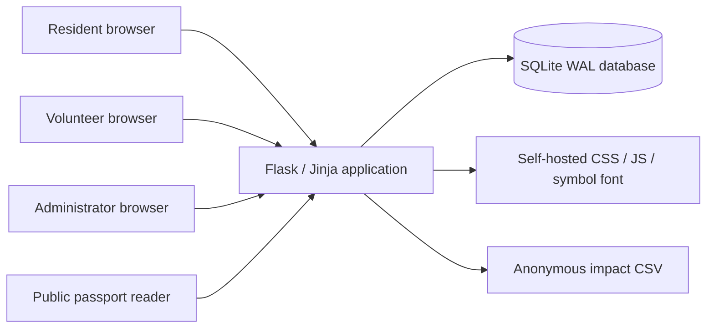
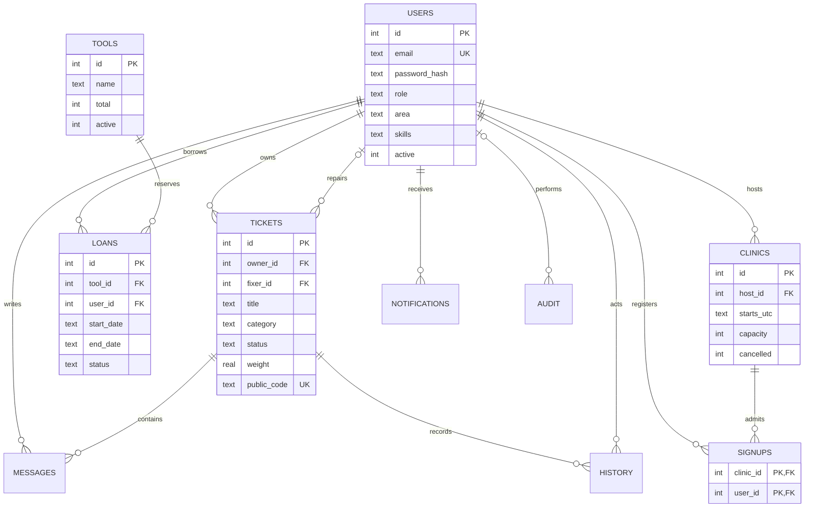
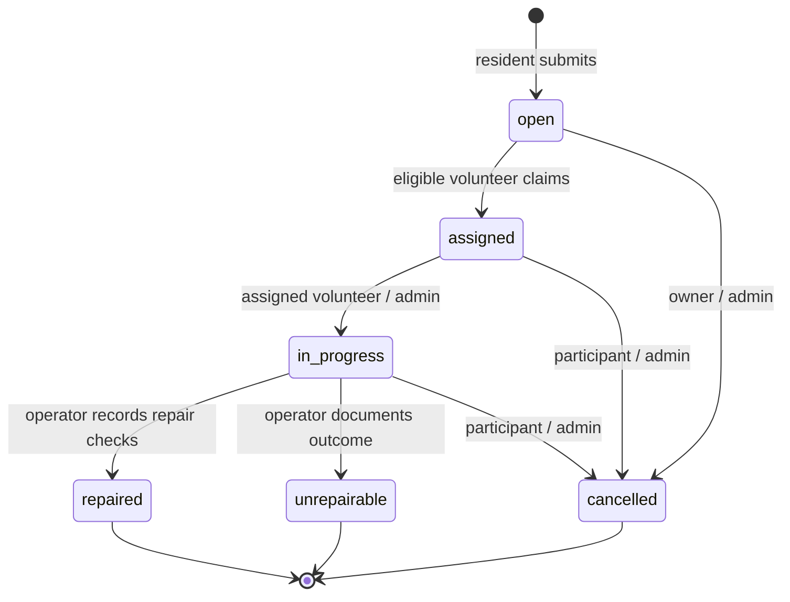
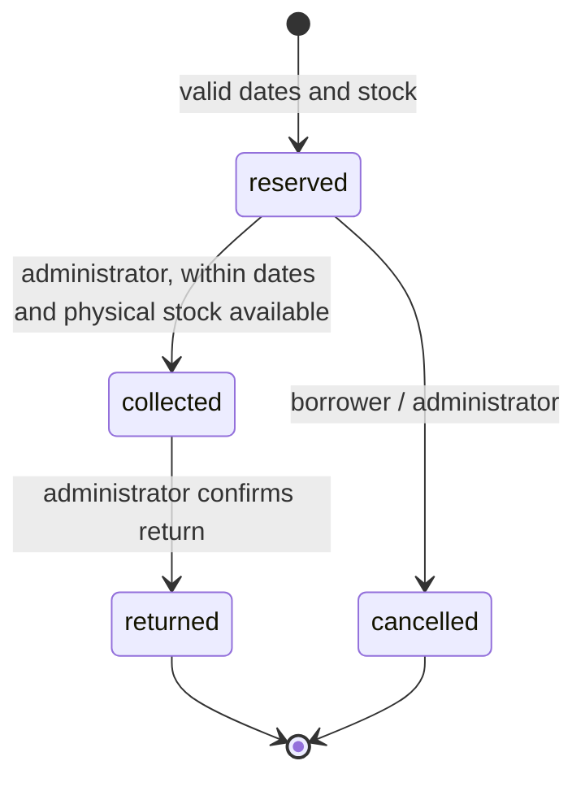

# Architecture and detailed design

## System context



No external API is required. Actual repair work and physical custody handovers occur outside the application. The application records those actions; it cannot independently verify them.

## Request processing

1. Load the active user from the signed session and the database; clear disabled sessions.
2. Create/validate CSRF tokens. Every POST requires a token and acquires a SQLite write transaction using `BEGIN IMMEDIATE`.
3. Check role and object access in route functions. Validate bounded input; interpolate values into templates with autoescaping, never SQL strings.
4. Apply the domain mutation, record history/audit and create notifications within the same transaction.
5. Commit responses below HTTP 400; roll back rejected requests. Domain `ValueError` also explicitly rolls back and renders HTTP 422. Close the connection at request teardown.
6. Return HTML with CSP, nosniff, anti-framing, same-origin referrer and no-store headers.

Login failures intentionally return an HTML error on HTTP 200 so their attempt records commit; locked-out requests return 429. Foreign keys are enabled on each connection. The 15-second SQLite timeout bounds lock waits. WAL allows concurrent reads but one writer: suitable for a small single-host hub, not a horizontally scaled high-throughput service.

## Entity relationship diagram



The ERD uses descriptive labels such as `password_hash` and `starts_utc`; actual column names are in `looplocal/schema.sql` (`password`, `starts`). All timestamps are UTC ISO-8601; all displayed event times convert to Malaysia time (UTC+8). Tool date-only values are interpreted using Malaysia's calendar date. Skills are a small constrained category list stored as comma-separated names; a future multi-category catalogue should normalize these to a join table.

Additional tables: `login_attempts` stores direct client IP and Unix timestamps for the local login throttle. It is pruned on login attempts older than 15 minutes. Notifications and audit records are server-side persistent state, not client-local state.

## Repair state machine



Owners cannot mark completed. No transition is accepted out of a terminal state; count-once impact follows directly. Claim rechecks availability after acquiring the write lock. Participants can retain access to their historical repair, while an unassigned volunteer loses access once another volunteer claims it.

## Tool custody state machine



For each inclusive date `d`, count active reservations where `start <= d <= end`. Also count collected items whose expected return is already overdue, because physical custody continues beyond the planned end. Reject if any day's count reaches `tools.total`. Check duplicate overlap for the same borrower/tool. Permitted window: today through 90 days in advance; at most seven inclusive calendar days. Separate daily checks avoid incorrectly rejecting a new booking spanning two sequential reservations when multiple copies exist.

Check-out additionally counts **all currently collected copies**. A previously valid reservation cannot be checked out if the physical copy is still with an overdue borrower. There are no copy serial numbers in this version; custody is at the tool-type count level.

## Volunteer ranking

```text
skill_score     = 60 if requested category is in volunteer.skills else 0
locality_score  = 25 if neighbourhood matches else 0
workload_score  = max(0, 15 - 5 * active_repairs)
total_score     = skill_score + locality_score + workload_score
```

Active workload = assigned + in-progress jobs. Filter to active volunteers excluding the item owner. Sort descending score, then ascending workload, then ascending stable user ID. Display the first three suggestions with explanations. Suggestions may include neighbours without the matching skill or who are at capacity; the UI shows the reasons/workload and claims enforce matching skill and capacity separately. This makes recommendations informational, not a guarantee of eligibility or an invitation sent to a person.

This is a deterministic rule-based ranker, not machine learning or geographically precise distance matching. “Essential” is a visible owner-provided flag; it does not silently alter the published score.

## Public passport boundary

The public query projects only ID, title, category, status, estimated weight, public code and creation date. Public history queries project only state and date. Owner names, volunteer names, area, description, messages and free-text history notes are not part of the passport projection. URLs use 18 random bytes encoded with `token_urlsafe`. Passports are shareable public records, not authentication tokens and not safety certificates. Titles are public on passports; users should not put personal details into item titles.

## Security and deployment boundaries

- Passwords: Werkzeug scrypt; sessions: Flask signing with random per-install key, HttpOnly, SameSite Lax, 12-hour lifetime.
- CSRF: random session token, constant-time comparison for every POST. Log out and administrative changes are never GET mutations.
- Input: limits, enumerated values, finite bounded weights, bound SQL parameters, no file uploads.
- Browser: no inline scripts/styles; strict same-origin CSP, local licensed symbol font, no third-party tracking assets.
- Authorization: role checks plus per-ticket participant checks; admin self-registration is prohibited.
- Admin moderation is a trusted capability. Audit is application-level, not tamper-proof against database/system administrators.
- Rate limit uses `request.remote_addr`; configure edge limits for real deployment. Do not blindly trust arbitrary forwarded IP headers.
- No email verification or password-reset email; administrators are created by CLI, not a public route.
- A formal penetration test, accessibility audit and load benchmark have not been performed.
